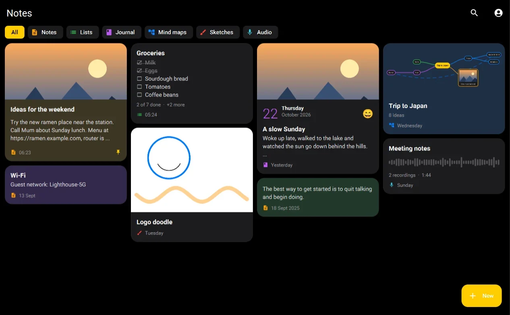
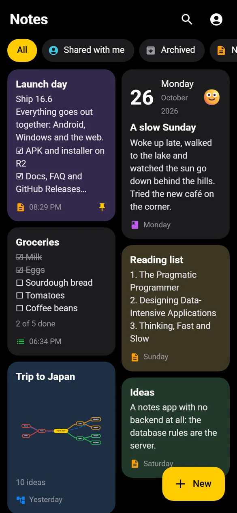
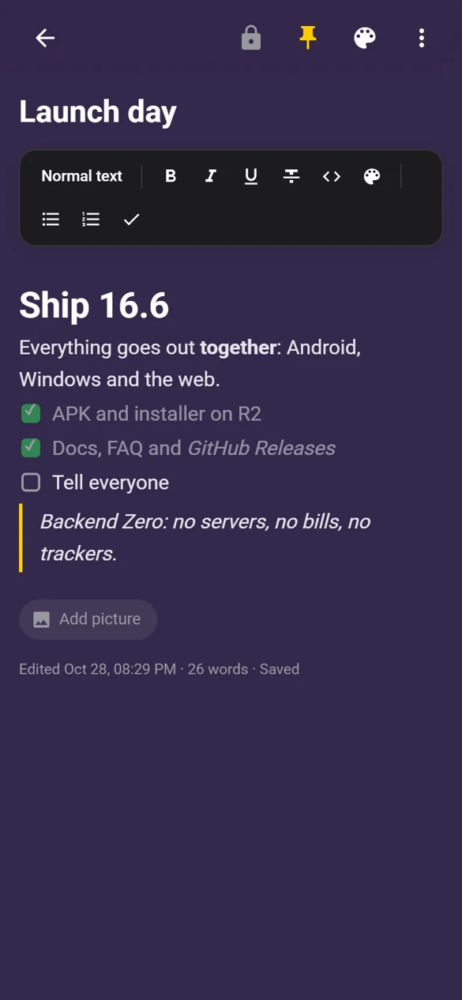
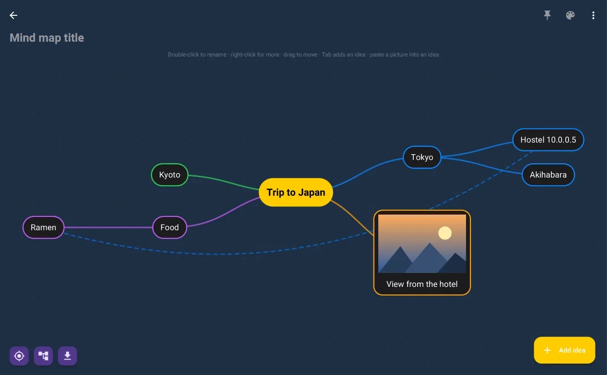
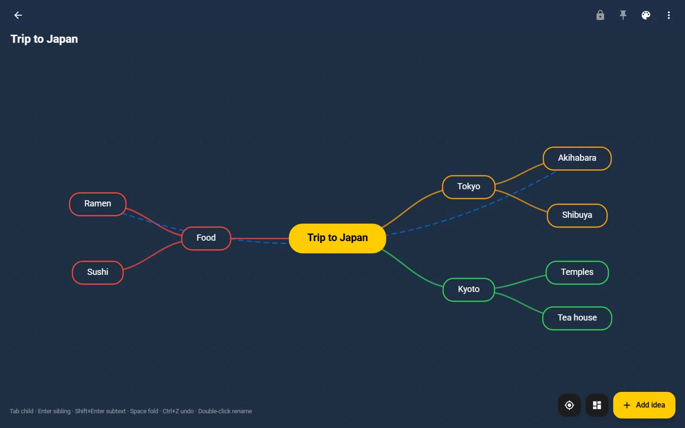

# Notes+

**Backend Zero. Everything else, infinite.**

A state-of-the-art notes app for Android, Windows and the web, with no servers of its own:
hosted for free, existing for free, and so free for everyone who uses it.

[Website](https://notes.talken.in) · [Web app](https://notes.talken.in/app/) · [Download](https://notes.talken.in/download.html) · [Docs](https://notes.talken.in/docs.html) · [Releases](https://github.com/Shashwat-Gupta57/Notes-Plus/releases)

---

  

<table>
  <tr>
    <td width="33%"></td>
    <td width="33%"></td>
    <td width="33%">
        </td>
  </tr>
  <tr>
    <td align="center">Your notes, on a phone</td>
    <td align="center">Text edited as it looks, saved as Markdown</td>
    <td align="center">Mind maps on Windows and the web</td>
  </tr>
</table>

## What it is

Six kinds of note: **text** edited as it looks (like Word, stored as Markdown), **checklists**,
**journal** days, **mind maps**, **sketches** and **voice recordings**. Works offline and without an
account; sign in to sync every device and to share notes with people.

| Platform | Get it |
|---|---|
| Android 7.0+ | APK from the [download page](https://notes.talken.in/download.html) or [Releases](https://github.com/Shashwat-Gupta57/Notes-Plus/releases) |
| Windows 10 / 11 | Installer or portable ZIP, Java built in |
| Web, macOS, iPhone, iPad | [notes.talken.in/app](https://notes.talken.in/app/), installable as an app |
| Linux | The web app today; native build **pending** |

## Backend Zero

No servers. No subscriptions. No compromises. There is no Notes+ API and no server code anywhere:

| Piece | Runs on |
|---|---|
| Website and web app | Static files on GitHub Pages |
| Accounts | Firebase Authentication |
| Notes, sharing, sync | Firebase Realtime Database, guarded by its security rules (the whole "backend") |
| Photos, videos, recordings | Each user's own Google Drive |
| Downloads and updates | Cloudflare R2 (`releases.talken.in`) and GitHub Releases, announced by [`version.json`](version.json) |

Every piece runs on a free tier, so the app costs nothing to keep alive and nothing to use. The
clients do the work: revision-checked sync that never overwrites by accident, on-device encryption
for locked notes and private spaces, and one Markdown note format shared by Java, JavaFX and
vanilla JS.

## The repository

One repository, three apps, one branch each:

| Branch | What | Build |
|---|---|---|
| [`master`](https://github.com/Shashwat-Gupta57/Notes-Plus/tree/master) | Android app, `version.json` | `./gradlew assembleDebug` (full JDK 21) |
| [`desktop`](https://github.com/Shashwat-Gupta57/Notes-Plus/tree/desktop) | Windows app (JavaFX) | `mvn javafx:run` (JDK 21) |
| [`web`](https://github.com/Shashwat-Gupta57/Notes-Plus/tree/web) | Website + web app (GitHub Pages) | none: static files, open `index.html` |

Releases are tagged `vX.Y.0` (Android and the shared release) and `vX.Y` (Windows), and every
release is published to both `releases.talken.in` and GitHub Releases with SHA-256 checksums.

## Contributing

Bug reports, ideas and pull requests are welcome. Start with [CONTRIBUTING.md](CONTRIBUTING.md);
please also read the [Code of Conduct](CODE_OF_CONDUCT.md). Found a security issue? See
[SECURITY.md](SECURITY.md) and report it privately.

## License

Notes+ is free software under the [GNU General Public License v3.0](LICENSE): use it, study it,
change it and share it, and keep what you build from it open too.

© 2026 Shashwat Gupta · Flex Studios
